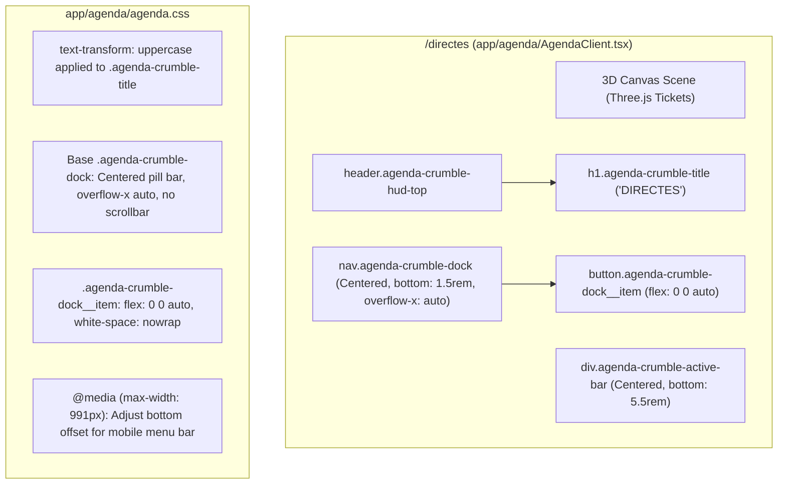

# Directes Header & Concert Dock Layout Harmonization

*   **Author:** aaronens3
*   **Status:** Approved
*   **Date:** 2026-11-16

--------------------------------------------------------------------------------

## Overview

This document specifies visual and layout adjustments to the `/directes` page in the Miquel Gil web application. The goal is to bring typographic consistency to the page title and harmonize the concert date navigation dock so that desktop viewports share the clean, compact horizontal scrolling dock previously exclusive to mobile viewports.

## The Problem

On the `/directes` page:
1. **Title casing mismatch**: The page title renders in mixed case (`Directes`) while other top-level section titles and brand headers across the site use uppercase formatting (`DIRECTES`), causing visual inconsistency.
2. **Desktop concert navigation dock fragmentation**: On desktop displays, the concert dates list (`.agenda-crumble-dock`) sits pinned to the bottom-left corner and wraps items across multiple lines, which diverges from the cleaner, modern mobile presentation where dates are housed in a centered, horizontal scrolling pill dock at the bottom of the screen.

## Goals

*   Transform the `/directes` page heading to uppercase (`DIRECTES`) both in markup and via CSS styling (`text-transform: uppercase`).
*   Harmonize the concert dates dock (`.agenda-crumble-dock`) on desktop to match the mobile presentation: a centered, horizontal scrollable dock anchored at the bottom of the viewport with smooth scrolling, rounded borders, backdrop blur, and ivory aesthetics.
*   Ensure zero regression in concert selection interactions, active concert detail views, and responsiveness across all breakpoints.

## Non-Goals

*   Altering the global header navigation bar (`.agenda-crumble-nav-island` / `.crumble-nav-row`).
*   Modifying the backend concert data structure, API endpoints, or database schemas.
*   Changing other pages or the concert detail modal/drawer logic beyond positioning and dock aesthetics.

## Open Questions

*   None identified; author confirmed that the concert dates dock (`agenda-crumble-dock`) is the component adopting the mobile horizontal scrollable bar layout on desktop.

--------------------------------------------------------------------------------

## Critical User Journeys (CUJs)

### CUJ 1: Browsing concert dates on desktop viewports

*   **Given**: A user loads `/directes` on a desktop monitor (> 991px).
*   **When**: The user observes the page header and navigates through upcoming concerts at the bottom.
*   **Then**:
    *   The page header displays `DIRECTES` in clean uppercase serif typography.
    *   The concert dock appears centered horizontally at the bottom of the viewport as a single continuous scrollable strip.
    *   If dates exceed the available width, the dock scrolls smoothly horizontally with hidden scrollbars.
    *   Hovering or clicking a date highlights the item and focuses the corresponding 3D ticket paper in the scene.

### CUJ 2: Opening active concert details on desktop

*   **Given**: A user clicks a concert date from the dock or clicks a 3D ticket paper.
*   **When**: The active concert state is triggered (`activeConcert` is non-null).
*   **Then**:
    *   The active concert action bar (`.agenda-crumble-active-bar`) remains anchored horizontally centered directly above the concert dock (`bottom: 5.5rem`), presenting ticket and venue links without layout shift or overlapping the dock items.

--------------------------------------------------------------------------------

## Technical Plan (Architecture)

### Component Hierarchy & Styling Flow

### 1. Title Uppercase Harmonization

In `app/agenda/AgendaClient.tsx` (line 1071):
- Update the heading text from `Directes` to `DIRECTES`.

In `app/agenda/agenda.css` (`.agenda-crumble-title`):
- Add `text-transform: uppercase;` to guarantee visual consistency regardless of runtime locale rendering.

### 2. Concert Dock Layout Refactoring

In `app/agenda/agenda.css`:
- **Base rule (`.agenda-crumble-dock`)**:
  - Replace `left: 2.25rem; bottom: 1.5rem; flex-wrap: wrap;` with:
    - `left: 50%; transform: translateX(-50%); bottom: 1.5rem;`
    - `width: max-content; max-width: calc(100vw - 3rem);`
    - `display: flex; flex-wrap: nowrap;`
    - `overflow-x: auto; overflow-y: hidden;`
    - `scrollbar-width: none; -webkit-overflow-scrolling: touch;`
    - `border: 0.5px solid rgba(17, 17, 17, 0.28);`
    - `box-shadow: 0 4px 18px rgba(0, 0, 0, 0.18);`
  - Hide scrollbar via `.agenda-crumble-dock::-webkit-scrollbar { display: none; }`.
- **Dock items (`.agenda-crumble-dock__item`)**:
  - Ensure `flex: 0 0 auto; white-space: nowrap;` and remove multi-line bottom borders (`border-bottom: none`).
  - Maintain hover/active states (`background-color: #111111; color: #ffffff`).
- **Mobile overrides (`@media (max-width: 991px)` and `@media (max-width: 480px)`)**:
  - Retain existing bottom offsets (`bottom: calc(4.8rem + env(safe-area-inset-bottom, 0px))`) so the dock floats neatly above the mobile global navigation dock.
  - Set `left: 0.75rem; right: 0.75rem; transform: none; width: auto; max-width: none;` on mobile where edge-to-edge margin alignment is preferred over fixed centering.

--------------------------------------------------------------------------------

## Alternatives Considered

### Alternative A: Converting the global site navigation island to mobile dock style on desktop

*   **Pros**: Complete visual parity between desktop and mobile navigation mechanics across the entire site.
*   **Cons**: Expands scope beyond `/directes`, breaks established desktop spatial patterns across `/musica`, `/lletres`, and `/bio`, and increases interaction friction for mouse users who expect standard desktop top-navigation.
*   **Reason for Rejection**: Rejected by author: Scope was explicitly defined during intake to apply solely to the concert dates dock (`agenda-crumble-dock`) on `/directes`.

### Alternative B: Relocating the desktop concert dates dock to a vertical side panel

*   **Pros**: Leaves the bottom area completely clear for active concert metadata and action buttons.
*   **Cons**: Deviates sharply from the mobile horizontal experience, increases visual clutter over the 3D ticket scene canvas, and requires distinct desktop-only layout code.
*   **Reason for Rejection**: Rejected by author: The objective is visual harmonization with the mobile horizontal scrollable dock, not introducing a third layout paradigm.

### Alternative C: Pure CSS uppercase without JSX text synchronization

*   **Pros**: Modifies only `agenda.css` without touching `AgendaClient.tsx`.
*   **Cons**: Generates mismatched DOM text nodes for search indexing, screen readers, and headless scrapers.
*   **Reason for Rejection**: Rejected by author: Updating both JSX markup and CSS rules provides accessible, robust typography across all consumption modes.

--------------------------------------------------------------------------------

## Non-Functional Requirements

*   **Performance**: Dock styles rely solely on composite-friendly CSS properties (`transform`, `opacity`, `background-color`, hardware-accelerated horizontal scrolling), preserving 60fps WebGL rendering in the Three.js background canvas.
*   **Accessibility**: Title retains semantic `<h1>` status with uppercase text accessible to screen readers; dock retains proper ARIA roles and tab indices for keyboard navigation.
*   **Cross-Browser**: Scrollbar hiding utilizes standard `scrollbar-width: none` paired with vendor-prefixed `::-webkit-scrollbar { display: none; }` to cover Chrome, Safari, Firefox, and Edge.

--------------------------------------------------------------------------------

## Detailed Implementation Plan

### Target Files to Create/Modify

#### 1. `app/agenda/AgendaClient.tsx` (Modify)

*   **Type / Scope**: React Client Component for `/directes`.
*   **Rationale**: Ensure clean DOM text capitalization for accessibility and initial SSR markup.
*   **Proposed Changes**:
    *   Locate `<h1 className="agenda-crumble-title">Directes</h1>` (line 1071).
    *   Change text node to uppercase: `<h1 className="agenda-crumble-title">DIRECTES</h1>`.

#### 2. `app/agenda/agenda.css` (Modify)

*   **Type / Scope**: Component stylesheet for the agenda page.
*   **Rationale**: Implement uppercase typography rule and promote the centered horizontal scrollable dock layout to desktop viewports.
*   **Proposed Changes**:
    *   Add `text-transform: uppercase;` to `.agenda-crumble-title`.
    *   Refactor base `.agenda-crumble-dock`:
        *   Positioning: `left: 50%`, `transform: translateX(-50%)`, `bottom: 1.5rem`.
        *   Layout: `display: flex`, `flex-wrap: nowrap`, `width: max-content`, `max-width: calc(100vw - 3rem)`.
        *   Scroll: `overflow-x: auto`, `overflow-y: hidden`, `scrollbar-width: none`, `-webkit-overflow-scrolling: touch`.
        *   Visuals: `border: 0.5px solid rgba(17, 17, 17, 0.28)`, `box-shadow: 0 4px 18px rgba(0, 0, 0, 0.18)`, `background-color: rgba(244, 242, 236, 0.94)`, `backdrop-filter: blur(8px)`.
    *   Add `.agenda-crumble-dock::-webkit-scrollbar { display: none; }` in base scope.
    *   Update base `.agenda-crumble-dock__item`:
        *   `flex: 0 0 auto`, `white-space: nowrap`, `border-bottom: none`.
    *   Update mobile media queries (`@media (max-width: 991px)`):
        *   Set `left: 0.75rem; right: 0.75rem; transform: none; width: auto; max-width: none;` to maintain edge-to-edge margins on compact viewports.
        *   Preserve bottom spacing for mobile navigation island (`bottom: calc(4.8rem + env(safe-area-inset-bottom, 0px))`).

### Verification Plan

*   **Build Verification**: Run `npm run build` to ensure static page generation succeeds for all 24 routes with zero TypeScript or CSS syntax errors.
*   **Visual Regression Capture**:
    *   Capture desktop screenshot (`1280x800`) showing the uppercase `DIRECTES` title and the centered, single-row horizontal dock.
    *   Capture mobile screenshot (`390x844`) verifying that mobile layout and navigation spacing remain intact.
    *   Test active concert state to verify that `.agenda-crumble-active-bar` renders cleanly above the centered dock.
*   **Workspace Hygiene**: Delete temporary test scripts and screenshots in `scratch/`.

--------------------------------------------------------------------------------

*Drafted with EGM*
